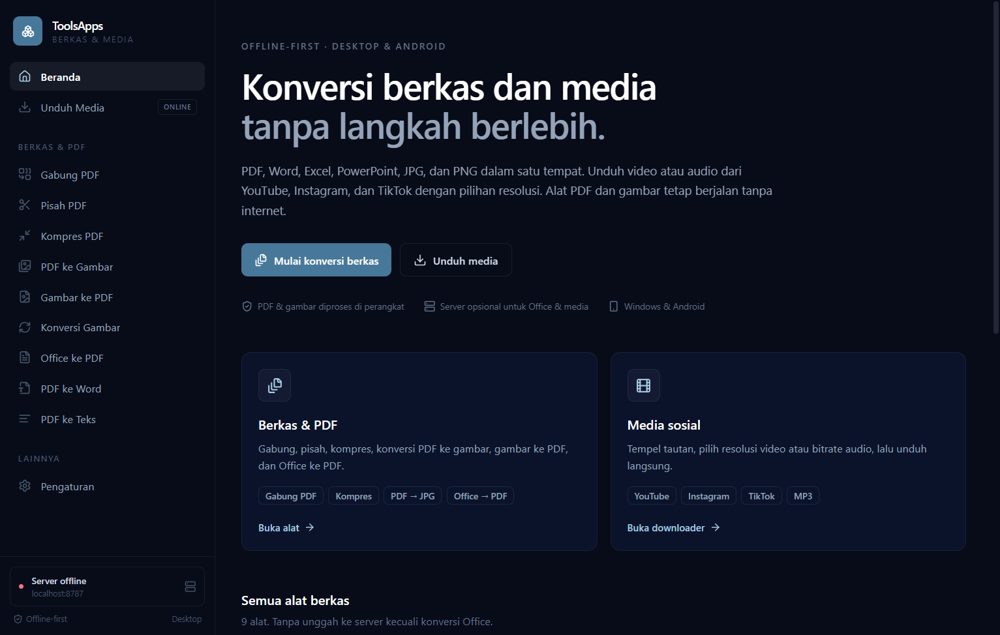

# ToolsApps

Konversi berkas dan unduh media dalam satu aplikasi. ToolsApps berjalan sebagai **web/PWA**, **aplikasi desktop (Electron)**, dan **aplikasi Android (Capacitor)**. Alat PDF dan gambar diproses sepenuhnya di perangkat, sedangkan konversi Office tingkat lanjut dan unduhan media memakai server opsional.

## Tujuan dan kontribusi AI

ToolsApps adalah proyek pribadi untuk edukasi, eksperimen, dan menguji kemampuan AI dalam membantu proses pengembangan perangkat lunak. Pengembangannya melibatkan bantuan AI; proyek ini bukan produk komersial dan dibuat untuk keperluan belajar serta pengujian pribadi.



## Daftar isi

- [Fitur](#fitur)
- [Arsitektur](#arsitektur)
- [Prasyarat](#prasyarat)
- [Mulai cepat](#mulai-cepat)
- [Server](#server)
- [Aplikasi desktop](#aplikasi-desktop)
- [Aplikasi Android](#aplikasi-android)
- [Docker](#docker)
- [Build dan verifikasi](#build-dan-verifikasi)
- [Batasan](#batasan)
- [Keamanan untuk produksi](#keamanan-untuk-produksi)
- [Struktur proyek](#struktur-proyek)
- [Pemecahan masalah](#pemecahan-masalah)

## Fitur

### Alat berkas

| Alat | Cara kerja | Offline |
| --- | --- | --- |
| Gabung PDF | Menggabungkan beberapa PDF sesuai urutan berkas | Ya |
| Pisah PDF | Memecah rentang halaman menjadi PDF/ZIP | Ya |
| Kompres PDF | Mode aman (struktur dipertahankan) atau kuat (rasterisasi) | Ya |
| PDF ke Gambar | Setiap halaman menjadi JPG/PNG, hasil banyak halaman dikemas ZIP | Ya |
| Gambar ke PDF | Menggabungkan JPG/PNG menjadi satu PDF | Ya |
| Konversi Gambar | JPG, PNG, dan WebP dengan pengaturan kualitas | Ya |
| Office ke PDF | Prioritas: LibreOffice lokal (desktop) → LibreOffice server → fallback DOCX/XLSX/CSV/ODS | Sebagian |
| PDF ke Word | Ekstraksi teks dan tabel sederhana ke DOCX | Ya (beta) |
| PDF ke Teks | Ekstraksi teks per halaman ke TXT | Ya |

### Unduh media

- Mendukung tautan **YouTube**, **Instagram Reels**, dan **TikTok** melalui `yt-dlp`.
- Pratinjau judul, kanal, durasi, dan thumbnail sebelum mengunduh.
- Video **MP4** dengan pilihan resolusi hingga 4K (mengikuti kualitas sumber).
- Audio **MP3** dengan pilihan bitrate 96/128/192/256/320 kbps.
- Progres unduhan, pembatalan pekerjaan, dan tautan unduhan hasil.
- Membutuhkan server yang terhubung internet.

### Platform

| Platform | Status | Penyimpanan hasil |
| --- | --- | --- |
| Web / PWA | Berjalan | Unduhan browser |
| Windows (Electron) | Berjalan, installer NSIS tersedia | Dialog **Simpan sebagai** |
| Android (Capacitor) | APK debug & rilis bertanda tangan tersedia di `dist/android/`; belum diuji di perangkat | Folder `Documents/ToolsApps` (penyimpanan aplikasi) + dialog bagikan |
| Linux/macOS (Electron) | Kode siap, belum diuji | Dialog **Simpan sebagai** |

### Desain antarmuka

Tema gelap minimalis dengan palet navy. Token warna dan komponen dasar berada di `apps/web/tailwind.config.js` dan `apps/web/src/index.css`.

| Peran | Warna | Keterangan |
| --- | --- | --- |
| Latar aplikasi | `#080C19` | Near-black navy, bukan hitam murni |
| Permukaan / kartu | `#0B132B` | Satu tingkat lebih terang dari latar |
| Permukaan hover | `#101A33` | Kontras sangat halus |
| Aksen utama | `#47789A` → `#5F94B8` | Tombol utama dan status aktif |
| Aksen teks | `#A9CBE3` | Tautan dan ikon aktif, dipakai hemat |
| Teks utama | `#FFFFFF` | Judul dan label penting |
| Teks sekunder | `#94A3B8` | Body text dan keterangan |

Aturan yang diterapkan: tanpa gradasi neon, tanpa glow, bayangan sangat halus, border 1px ber-opacity rendah, whitespace lega, ikon line-art Lucide, dan maksimal dua hierarki ukuran teks per modul visual.

## Arsitektur

```text
┌─────────────────────────────────────────────────────────────┐
│  apps/web — React 19 + Vite + Tailwind + Zustand            │
│                                                             │
│  Alat offline: pdf-lib, pdfjs-dist, canvas, JSZip,          │
│  jsPDF, SheetJS, mammoth, docx                              │
│                                                             │
│  Runtime: browser/PWA │ Electron │ Android (Capacitor)      │
└───────────────┬──────────────────────────────┬──────────────┘
                │ window.toolsBridge (IPC)      │ HTTP
                ▼                               ▼
┌───────────────────────────┐   ┌──────────────────────────────┐
│ apps/desktop — Electron   │   │ apps/server — Fastify 5      │
│                           │   │                              │
│ • dialog simpan berkas    │   │ • LibreOffice headless       │
│ • LibreOffice lokal       │   │ • yt-dlp + FFmpeg            │
│ • deteksi kapabilitas     │   │ • job, progres, pembatalan   │
│ • protokol app://         │   │ • pembersihan berkas (TTL)   │
└───────────────────────────┘   └──────────────────────────────┘
```

Alur konversi Office:

1. **Desktop** mencoba LibreOffice yang terpasang di komputer pengguna.
2. Bila tidak ada, aplikasi memakai server yang dikonfigurasi (bila aktif).
3. Bila server juga tidak tersedia, DOCX, XLSX, CSV, dan ODS memakai konversi perkiraan di browser. DOC, RTF, ODT, dan PPTX tidak memiliki fallback offline dan memerlukan LibreOffice.

## Prasyarat

- **Node.js 20+** (diuji dengan Node 24.20.0) dan npm 10+.
- Windows 10/11, Linux, atau macOS untuk pengembangan web/desktop.
- Opsional untuk fitur server:
  - **LibreOffice** (Writer, Calc, Impress)
  - **yt-dlp**
  - **FFmpeg**
- Untuk Android:
  - **JDK 21**
  - **Android SDK 35** + build-tools 35 + platform-tools (cukup command-line tools; Android Studio opsional)
- Untuk Docker: Docker Desktop / Docker Engine dengan Compose v2.

## Mulai cepat

```bash
npm install
```

Jika npm meminta persetujuan skrip instalasi (Electron/esbuild):

```bash
npm install-scripts approve electron esbuild core-js
```

Jalankan aplikasi web dan server di dua terminal:

```bash
npm run dev:web      # http://localhost:5173
npm run dev:server   # http://localhost:8787
```

Jalankan versi desktop (Vite + Electron):

```bash
npm run dev:desktop
```

Lalu buka **Pengaturan** di aplikasi untuk memeriksa/mengubah URL server. Nilai default: `http://localhost:8787`.

### Perintah penting

| Perintah | Kegunaan |
| --- | --- |
| `npm run typecheck` | Pemeriksaan TypeScript seluruh workspace |
| `npm run build` | Build web, server, dan kode desktop |
| `npm run dev:web` | UI web (Vite) |
| `npm run dev:server` | Server Fastify dengan auto-reload |
| `npm run dev:desktop` | UI + Electron |
| `npm run dist:win` | Installer Windows NSIS (butuh akses pembuatan symlink) |
| `npm run dist:win:unsigned` | Installer Windows tanpa edit resource/signing (ikon default) |
| `npm run android:sync` | Build web lalu salin aset ke proyek Android |
| `npm run android:build` | Build web, salin aset, lalu hasilkan APK debug + rilis ke `dist/android/` |
| `npm run icons` | Regenerasi ikon PWA, Electron, Android, dan splash |

## Server

Server menangani pekerjaan yang tidak dapat dilakukan murni di browser. Tanpa server, aplikasi tetap dapat memakai seluruh alat offline.

### Konfigurasi

Salin `apps/server/.env.example` menjadi `apps/server/.env`:

```env
PORT=8787
HOST=0.0.0.0
MAX_UPLOAD_MB=200
JOB_TTL_MINUTES=120
DATA_DIR=
CORS_ORIGIN=*
SOFFICE_PATH=
YTDLP_PATH=
FFMPEG_PATH=
MAX_MEDIA_MINUTES=180
LOG_LEVEL=info
```

| Variabel | Default | Keterangan |
| --- | --- | --- |
| `PORT` | `8787` | Port HTTP |
| `HOST` | `0.0.0.0` | Alamat bind; gunakan `127.0.0.1` bila hanya lokal |
| `DATA_DIR` | folder temp OS | Lokasi berkas pekerjaan |
| `MAX_UPLOAD_MB` | `200` | Batas unggah Office |
| `JOB_TTL_MINUTES` | `120` | Umur hasil sebelum dibersihkan |
| `CORS_ORIGIN` | `*` | Pisahkan beberapa origin dengan koma |
| `SOFFICE_PATH` | deteksi otomatis | Path `soffice`/`soffice.exe` |
| `YTDLP_PATH` | deteksi otomatis | Path `yt-dlp` |
| `FFMPEG_PATH` | deteksi otomatis | Path `ffmpeg` |
| `MAX_MEDIA_MINUTES` | `180` | Batas durasi media |
| `LOG_LEVEL` | `info` | Level log Fastify |

### Memasang komponen

**Windows**

```powershell
winget install TheDocumentFoundation.LibreOffice
winget install yt-dlp.yt-dlp
winget install Gyan.FFmpeg
```

Bila deteksi otomatis gagal, isi `SOFFICE_PATH`, `YTDLP_PATH`, dan `FFMPEG_PATH` di `.env`. Lokasi umum:

- `C:\Program Files\LibreOffice\program\soffice.exe`
- `%USERPROFILE%\yt-dlp.exe`
- `C:\ffmpeg\bin\ffmpeg.exe`

**Linux (Debian/Ubuntu)**

```bash
sudo apt update
sudo apt install libreoffice ffmpeg python3-pip
python3 -m pip install --user -U yt-dlp
```

**macOS**

```bash
brew install --cask libreoffice
brew install yt-dlp ffmpeg
```

Periksa hasil deteksi:

```bash
curl http://localhost:8787/api/health
```

Contoh respons:

```json
{
  "ok": true,
  "name": "ToolsApps Server",
  "version": "0.1.0",
  "capabilities": {
    "libreoffice": { "available": true, "version": "LibreOffice 25..." },
    "ytDlp": { "available": true, "version": "2026.10.26" },
    "ffmpeg": { "available": true, "version": "ffmpeg version 7..." }
  }
}
```

### Endpoint

| Metode | Path | Body | Keterangan |
| --- | --- | --- | --- |
| `GET` | `/api/health` | – | Status dan kapabilitas biner |
| `POST` | `/api/convert/office` | multipart `file` | Memulai konversi Office → PDF (`202`) |
| `POST` | `/api/media/inspect` | `{ "url": "..." }` | Metadata dan resolusi tersedia |
| `POST` | `/api/media/download` | `{ "url", "mode": "video\|audio", "quality": 1080 }` | Memulai unduhan (`202`) |
| `GET` | `/api/jobs/:id` | – | Status, progres, pesan, nama berkas |
| `POST` | `/api/jobs/:id/cancel` | – | Menghentikan proses |
| `GET` | `/api/jobs/:id/file` | – | Mengunduh hasil |

Catatan:

- `quality` untuk video adalah tinggi piksel (misalnya `720`, `1080`, `2160`); untuk audio adalah bitrate kbps.
- Job disimpan di memori dan berkas di disk. Keduanya hilang setelah TTL atau saat server dimulai ulang.
- Server sengaja mengembalikan pesan kesalahan berbahasa Indonesia.

## Aplikasi desktop

### Pengembangan

```bash
npm run dev:desktop
```

Electron memuat renderer melalui protokol kustom `app://toolsapps/index.html`. Saat pengembangan, `TOOLSAPP_DEV_URL=http://localhost:5173` dipakai agar hot reload tetap berjalan.

### Build installer Windows

```bash
npm run dist:win
```

Hasil:

```text
apps/desktop/release/ToolsApps-0.1.0-Setup.exe
```

Installer bersifat **unsigned** kecuali Anda menyediakan sertifikat code signing. Untuk produksi, atur variabel lingkungan `CSC_LINK` dan `CSC_KEY_PASSWORD` (atau gunakan `win.signtoolOptions` di `apps/desktop/package.json`).

**Masalah symlink saat build Windows.** `electron-builder` mengekstrak paket `winCodeSign` yang berisi symlink macOS. Jika muncul:

```text
ERROR: Cannot create symbolic link : A required privilege is not held by the client
```

aktifkan **Windows Developer Mode** atau jalankan terminal sebagai Administrator, lalu ulangi. Alternatif tanpa edit resource:

```bash
npm run dist:win:unsigned
```

Opsi unsigned tidak menyematkan ikon kustom dan tidak menyentuh metadata executable, tetapi tetap menghasilkan installer yang dapat dipakai.

### Ikon

Ikon desktop berada di `apps/desktop/build/icon.ico` dan `icon.png`. Regenerasi semua ikon:

```bash
npm run icons
```

Skrip membuat aset tanpa dependensi biner tambahan: PWA 192/512, maskable, Apple touch icon, ICO multi-ukuran, ikon Android adaptif/legacy, dan splash screen gelap.

## Aplikasi Android

Proyek Capacitor berada di `apps/web/android` dengan:

- App ID: `id.toolsapps.app`
- Nama aplikasi: `ToolsApps`
- `compileSdk`/`targetSdk`: 35
- `minSdk`: 23

### Prasyarat

1. Pasang **JDK 21** dan pastikan `JAVA_HOME` mengarah ke JDK tersebut.
2. Pasang **Android SDK 35** beserta `build-tools;35.0.0` dan `platform-tools`.
3. Setujui lisensi SDK (`sdkmanager --licenses`).

Android Studio tidak wajib. SDK dapat dipasang hanya dengan command-line tools:

```powershell
$sdk = "$env:LOCALAPPDATA\Android\Sdk"
& "$sdk\cmdline-tools\latest\bin\sdkmanager.bat" --sdk_root=$sdk `
  "platform-tools" "platforms;android-35" "build-tools;35.0.0"
```

### Sinkronisasi dan build

Satu perintah dari root proyek:

```bash
npm run android:build
```

Perintah ini menjalankan build web, `cap sync`, lalu `assembleDebug` dan `assembleRelease`. Skrip `scripts/build-android.mjs` mendeteksi JDK/SDK, menulis `local.properties`, dan menyalin hasil ke:

- `dist/android/ToolsApps-0.1.0-release.apk` — bertanda tangan, untuk dipasang di perangkat.
- `dist/android/ToolsApps-0.1.0-debug.apk` — untuk pengembangan.

Atau build manual:

```powershell
cd apps\web\android
.\gradlew.bat assembleRelease
```

Hasil Gradle berada di `apps/web/android/app/build/outputs/apk/release/app-release.apk`.

### Penandatanganan APK

Build rilis memakai keystore lokal di `apps/web/android/keystore/`:

- `toolsapps-release.jks`
- `keystore.properties` (password, alias, nama berkas)

Keduanya diabaikan Git. **Simpan cadangan keystore dan password di tempat aman**; tanpa keduanya, pembaruan aplikasi tidak dapat ditandatangani dengan identitas yang sama.

Untuk membuat keystore baru:

```powershell
keytool -genkeypair -v -keystore apps\web\android\keystore\toolsapps-release.jks `
  -alias toolsapps -keyalg RSA -keysize 2048 -validity 10000
```

Isi `keystore.properties`:

```properties
storePassword=...
keyPassword=...
keyAlias=toolsapps
storeFile=toolsapps-release.jks
```

Tanpa berkas tersebut, `assembleRelease` tetap berjalan tetapi menghasilkan APK **unsigned** yang tidak bisa langsung dipasang. Untuk Play Store, gunakan **AAB** (`bundleRelease`) dan tombol Play App Signing.

### Memasang APK

1. Salin `dist/android/ToolsApps-0.1.0-release.apk` ke perangkat (kabel USB, Google Drive, atau `adb push`).
2. Buka berkas APK, lalu izinkan **Instal aplikasi tidak dikenal** untuk aplikasi Files/browser.
3. Atau lewat USB debugging:

```bash
adb install -r dist/android/ToolsApps-0.1.0-release.apk
```

APK rilis ditandatangani dengan keystore lokal. Selama keystore dan password yang sama dipakai, pembaruan dapat dipasang di atas versi sebelumnya (`-r`).

### Menghubungkan ke server

Buka **Pengaturan** di aplikasi Android dan isi URL server:

| Skenario | URL |
| --- | --- |
| Emulator Android Studio | `http://10.0.2.2:8787` |
| Perangkat fisik, Wi-Fi sama | `http://<IP-LAN-komputer>:8787` |
| Perangkat via USB + `adb reverse` | `http://localhost:8787` |

`adb reverse`:

```bash
adb reverse tcp:8787 tcp:8787
```

Pastikan firewall Windows mengizinkan koneksi masuk ke port 8787 untuk jaringan privat.

> **HTTP dan HTTPS.** WebView Android berjalan di origin `https://localhost`. Agar dapat memanggil server pengembangan HTTP di LAN, proyek ini menyetel `android:usesCleartextTraffic="true"` pada manifest **dan** `android.allowMixedContent: true` pada `capacitor.config.ts`. Untuk rilis publik, gunakan server HTTPS lalu matikan kedua opsi tersebut.

### Penyimpanan hasil di Android

Hasil ditulis ke `Documents/ToolsApps/<nama-berkas>` melalui plugin Filesystem (`Directory.Documents`). Pada Android 11+ folder tersebut berada dalam ruang penyimpanan aplikasi; aplikasi lain tidak selalu dapat membukanya langsung. Setelah tersimpan, aplikasi membuka dialog **Bagikan** agar berkas dapat dipindahkan atau dibagikan. Pada perangkat lama (Android ≤ 10) izin penyimpanan diminta saat pertama kali.

## Docker

Docker menyediakan server lengkap (LibreOffice + FFmpeg + yt-dlp) dan web PWA melalui Nginx.

```bash
docker compose up --build -d
```

| Layanan | URL | Keterangan |
| --- | --- | --- |
| Web | `http://localhost:8080` | PWA statis |
| Server | `http://localhost:8787` | API, CORS default `*` |

Buka **Pengaturan** di aplikasi web untuk menyesuaikan URL server bila diakses dari komputer/perangkat lain. Data pekerjaan disimpan di volume `server-data` (`/data` di container). Hentikan:

```bash
docker compose down
```

Hapus juga data:

```bash
docker compose down -v
```

Build pertama mengunduh Electron? Tidak. Build pertama server mengunduh paket LibreOffice dan **latest** `yt-dlp`, sehingga membutuhkan koneksi internet dan waktu beberapa menit. Untuk build reproducible, pin versi:

```bash
docker build -f apps/server/Dockerfile --build-arg YTDLP_VERSION=2026.10.26 -t toolsapps/server:0.1.0 .
```

`yt-dlp` perlu diperbarui berkala karena situs sumber sering berubah. Build ulang image server secara rutin.

## Build dan verifikasi

Perintah yang sudah dijalankan pada mesin pengembangan:

```bash
npm run typecheck
npm run build
npm -w @toolsapps/web run cap:sync
npm run android:build
npm -w @toolsapps/desktop run dist
```

Hasil verifikasi:

- **Typecheck** web, server, dan desktop: lulus.
- **Build produksi** web (Vite + PWA), server (tsc), dan desktop (tsc): lulus.
- **PWA offline**: `dist/sw.js` memuat 28 entri precache, termasuk `pdf.worker.min-*.mjs`, sehingga alat PDF tetap berfungsi offline setelah kunjungan pertama.
- **Uji asap Electron** (Electron 34.5.8, Windows): 9 alat inti lulus — gabung PDF, pisah PDF, PDF ke gambar, kompres, gambar ke PDF, konversi gambar, PDF ke teks, PDF ke Word, dan Office ke PDF; ditambah fallback DOCX/XLSX/CSV/ODS. Satu-satunya error konsol pada saat itu adalah `ERR_CONNECTION_REFUSED` ketika server tidak dijalankan (sesuai harapan).
- **Uji aplikasi terpaket** (`release/win-unpacked/ToolsApps.exe`) dengan UI baru: renderer dimuat dari `app://toolsapps/index.html`, `window.toolsBridge.runtime` bernilai `desktop`, halaman Beranda, Unduh Media, Pengaturan, dan alat PDF tampil, tanpa error konsol. Konversi **PDF ke Teks** dari berkas uji 2 halaman berhasil menghasilkan `toolsapps-smoke.txt`.
- **Pemeriksaan tema**: latar `rgb(8, 12, 25)`, panel `rgb(11, 19, 43)`, tombol utama `rgb(71, 120, 154)`, tanpa `background-image` gradien.
- **Server** (`node dist/index.js`, port 8788): `/api/health` mengembalikan `200` dengan kapabilitas `false` karena biner belum terpasang; header `X-Content-Type-Options: nosniff` dan `Referrer-Policy: no-referrer` aktif; URL media ke loopback ditolak `400`; job tidak dikenal mengembalikan `404`.
- **Integrasi server** dengan `yt-dlp` dan FFmpeg sementara (pengujian sebelumnya): inspeksi YouTube, unduhan MP4 hasil merge, dan ekstraksi MP3 (`audio/mpeg`) berhasil. Endpoint Office mengembalikan `503` saat LibreOffice tidak terpasang.
- **Installer Windows** `ToolsApps-0.1.0-Setup.exe` berhasil dibuat ulang (sekitar 83,5 MB, unsigned, ikon tema baru tersemat). Installer belum dijalankan sampai selesai.
- **Android**: build Gradle berhasil dengan JDK 21 + Android SDK 35 (`assembleDebug` dan `assembleRelease`, 328 task). APK rilis `ToolsApps-0.1.0-release.apk` berukuran 4,4 MB dan lolos verifikasi `apksigner` (skema v1 + v2, sertifikat `CN=ToolsApps`). APK debug 5,6 MB. Keduanya berisi 28 aset web termasuk `index.html`, `sw.js`, `manifest.webmanifest`, dan `pdf.worker.min-*.mjs`. APK belum dipasang/diuji di perangkat fisik atau emulator.
- **Docker**: langkah build server (instalasi workspace terfilter, `tsc`, `npm prune --omit=dev`, lalu start + health check) disimulasikan di folder bersih dan lulus. Image Docker penuh belum dijalankan karena Docker tidak tersedia di mesin ini.

## Batasan

- **PDF ke Word masih beta.** Hasil mengutamakan teks dan tabel sederhana; tata letak kompleks, kolom, dan gambar tidak selalu dipertahankan.
- **Kompres PDF mode kuat** merasterisasi halaman sehingga teks tidak lagi dapat dipilih. Mode ringan/sedang mempertahankan struktur tetapi penghematan lebih kecil.
- **Fallback DOCX/XLSX/CSV/ODS offline bersifat perkiraan.** Untuk hasil terbaik, gunakan LibreOffice lokal atau server. DOC, RTF, dan ODT selalu memerlukan LibreOffice.
- **PPTX tidak memiliki fallback offline.** Konversi memerlukan LibreOffice di desktop atau server.
- **Unduhan media membutuhkan internet dan server.** Konten privat, perlu login, atau ber-DRM tidak didukung. Kualitas video dibatasi sumber; audio MP3 memerlukan FFmpeg.
- **Kepatuhan layanan.** Unduh hanya konten yang Anda berhak gunakan dan patuhi ketentuan layanan masing-masing platform.
- **Job server tidak persisten.** Restart server menghapus antrean dan hasil. Untuk produksi, gunakan penyimpanan persisten/queue.
- **PWA memerlukan HTTPS** untuk service worker dan instalasi, kecuali `localhost`.
- **Android belum teruji di perangkat fisik/emulator** dalam pengembangan ini.
- **Server belum memiliki autentikasi, pembatasan laju, atau kuota pengguna.**

## Keamanan untuk produksi

Server ini dirancang untuk pengembangan lokal/LAN. Sebelum dipublikasikan:

1. Jalankan di belakang reverse proxy HTTPS (Caddy, Nginx, atau Traefik).
2. Tambahkan autentikasi (token/API key atau SSO) dan pembatasan laju.
3. Batasi `CORS_ORIGIN` ke domain aplikasi, jangan `*`.
4. Validasi ulang URL media, batasi ukuran/durasi, dan pertimbangkan allowlist domain.
5. Jalankan container sebagai pengguna non-root (sudah diterapkan) dan batasi resource CPU/memori.
6. Tinjau pembersihan berkas, retensi log, dan kebijakan privasi.
7. Jangan mengekspos `yt-dlp` atau LibreOffice secara langsung ke internet tanpa proteksi.
8. Gunakan sertifikat code signing untuk installer Windows dan tanda tangani APK/AAB Android.

## Struktur proyek

```text
ToolsApps/
├─ apps/
│  ├─ web/                  # React + Vite + PWA + Capacitor
│  │  ├─ src/core/          # Logika alat offline
│  │  ├─ src/lib/bridge.ts  # Deteksi runtime & penyimpanan
│  │  ├─ src/pages/         # Home, ToolPage, MediaPage, Settings
│  │  ├─ public/            # Ikon PWA
│  │  └─ android/           # Proyek Capacitor Android
│  ├─ desktop/              # Electron main/preload + electron-builder
│  │  ├─ build/             # icon.ico, icon.png
│  │  └─ scripts/           # Penyalin renderer
│  └─ server/               # Fastify, LibreOffice, yt-dlp, FFmpeg
│     ├─ src/
│     └─ Dockerfile
├─ scripts/
│  ├─ generate-icons.mjs
│  └─ build-android.mjs      # Build APK debug + rilis
├─ dist/android/             # APK hasil build
├─ docs/screenshots/
├─ docker-compose.yml
└─ README.md
```

## Pemecahan masalah

### Server mendeteksi komponen `false`

- Pastikan biner dapat dijalankan dari terminal: `soffice --version`, `yt-dlp --version`, `ffmpeg -version`.
- Isi path absolut di `apps/server/.env`.
- Di Windows, gunakan path dengan format `C:\\Program Files\\...` atau path maju.
- Restart server setelah mengubah `.env` (cache kapabilitas 60 detik).

### Aplikasi web tidak bisa menghubungi server

- Buka `http://localhost:8787/api/health` di browser.
- Periksa URL di **Pengaturan**.
- Pastikan `CORS_ORIGIN` mengizinkan origin aplikasi.
- Untuk perangkat lain, gunakan IP LAN, bukan `localhost`, dan buka firewall.

### Android tidak dapat mengunduh hasil

- Periksa izin penyimpanan pada perangkat lama.
- Pada Android 11+, hasil ditulis ke `Documents/ToolsApps` di ruang penyimpanan aplikasi melalui plugin Filesystem.
- Bila dialog bagikan tidak muncul, berkas tetap tersimpan; gunakan aplikasi Files atau dialog Bagikan untuk memindahkannya.

### Unduhan media gagal

- Perbarui `yt-dlp`: `yt-dlp -U` atau build ulang image Docker.
- Konten yang memerlukan login/cookie tidak didukung.
- Periksa pesan job: batas durasi, URL tidak valid, atau kualitas tidak tersedia.
- Pastikan FFmpeg tersedia untuk MP3 dan penggabungan video.

### Build desktop gagal karena symlink

Lihat bagian [Aplikasi desktop](#aplikasi-desktop). Aktifkan Developer Mode, jalankan sebagai Administrator, atau pakai `npm run dist:win:unsigned`.

### Build Android gagal

- Pastikan `JAVA_HOME` menunjuk ke JDK 21 (`java -version`).
- Pastikan `ANDROID_HOME` menunjuk ke SDK, atau biarkan skrip `scripts/build-android.mjs` mendeteksinya.
- Pasang paket SDK yang kurang: `sdkmanager "platforms;android-35" "build-tools;35.0.0" "platform-tools"`.
- Jalankan `npm run android:sync` setiap kali aset web berubah.
- Periksa `apps/web/android/local.properties` untuk lokasi SDK.
- Bila folder `release/win-unpacked` terkunci saat build desktop, tutup ToolsApps yang sedang berjalan.

---

Dibuat untuk penggunaan pribadi/internal. Periksa lisensi pustaka pihak ketiga sebelum distribusi publik.
